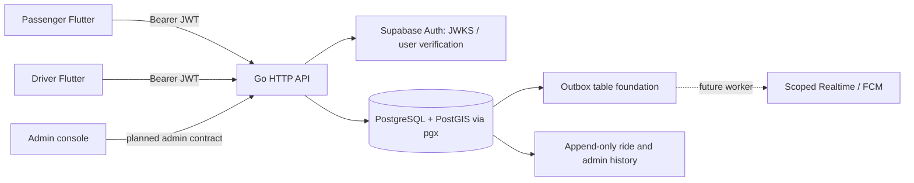

# Backend architecture

## Implemented boundary

E-GO uses a Go modular monolith as a separate HTTP service. Supabase Auth owns identities, PostgreSQL/PostGIS stores domain data, the Go API verifies access tokens and will own future business operations, and Realtime is a delivery mechanism. Current implementation includes the API process, JWT verification middleware, pgx pool, health/readiness routes, and database/configuration foundation. No ride-business handlers, workers, or realtime publications exist yet.

No mobile or browser client receives a service-role secret. The Go API does not use the service-role key or a database owner connection. App roles currently have only a small set of own-profile and active-service-area reads/own-profile updates. Ride, dispatch, location, ledger, audit, and support data have no client grants. Future operations must authenticate from the Supabase JWT, authorize the actor server-side, run database work in a transaction under `authenticated` with verified subject claims, validate state and revision, enforce idempotency, and write the entity plus event/outbox data in one transaction.

## Boundaries and modules

- **Identity:** `auth.users` is authoritative; `profiles` stores E-GO role and limited public profile data. A database trigger creates a passenger-default profile and passenger settings row. Go validates JWT signature, issuer, audience, expiry, role, and subject. Client metadata never grants a driver/admin role.
- **Driver/vehicle:** approval and vehicle data are persisted, but only trusted operations may change them.
- **Location:** PostGIS geography points and GiST indexes support spatial queries. Ingestion, freshness workers, and passenger-specific location access are not implemented.
- **Booking/ride:** request, quote, offer, intent, trip revision, and event structures are present. The server transition engine is not implemented.
- **Cash/reliability:** append-only ledger and audit tables plus transactional outbox structure are present. No workflow or dispatcher is implemented.

## Future realtime and location rules

Driver pings must be authenticated as that driver, monotonic and recent (blueprint threshold 90 seconds), frequency-limited, and checked for plausible movement before updating the latest location. Dispatch uses only approved drivers with fresh heartbeat and location; stale online flags do not qualify. Passengers can see a driver's position only for their assigned active trip. Realtime channels must be authorized per trip/driver; do not publish the location table broadly. Polling is the fallback, defaulting to the canonical 5-second server-configured minimum and mapping 404 to the documented not-found client state.

## Cash and event atomicity

Ride completion does not imply cash collection. A completed ride may have pending cash; a declaration is a separate, idempotent operation. Ledger corrections append a contra entry and an admin audit event. Ride state changes, event rows, and outbox rows must commit atomically; notification delivery is at-least-once and cannot mutate ride state.

## Deliberate omissions

No live Supabase project was accessed. No auth delivery provider, deployment target, worker scheduler, business API route, or client integration is configured. D2-D9 and staff-policy questions remain open where they affect later implementation or launch.
