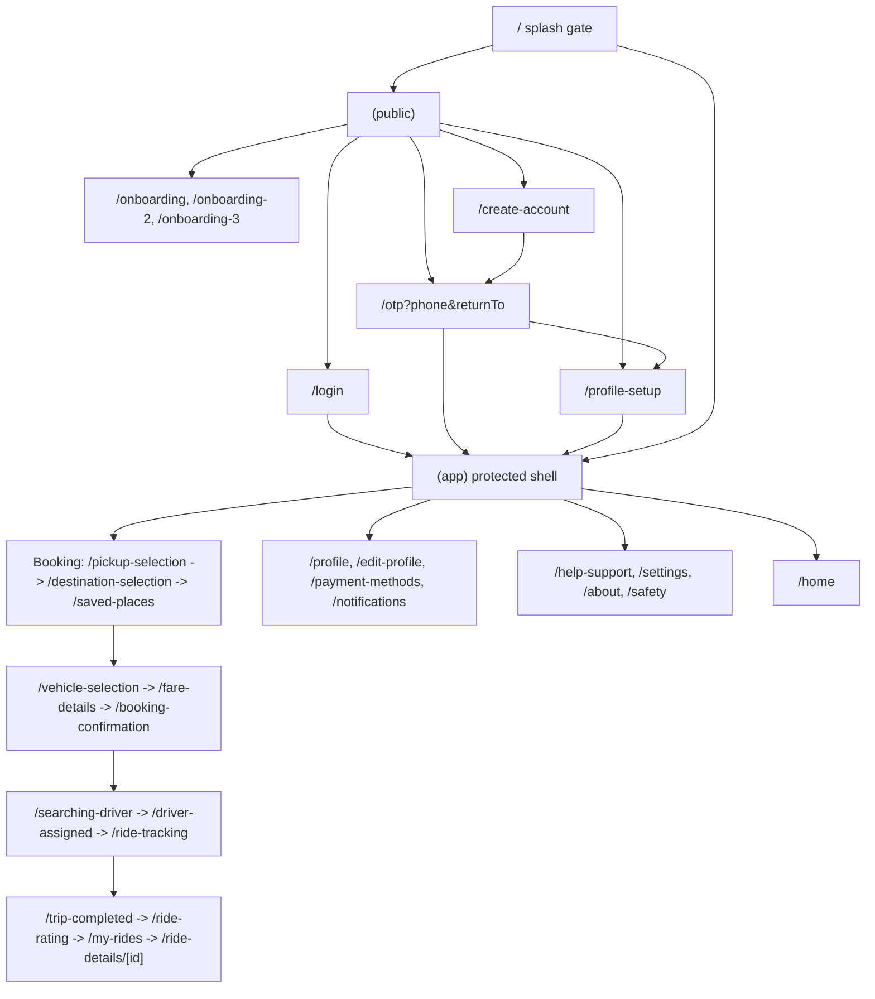
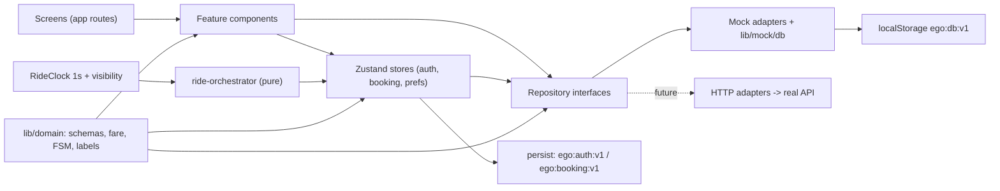
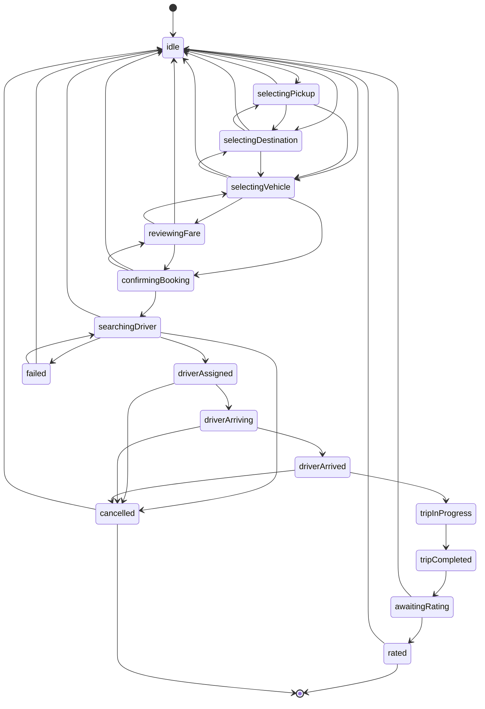
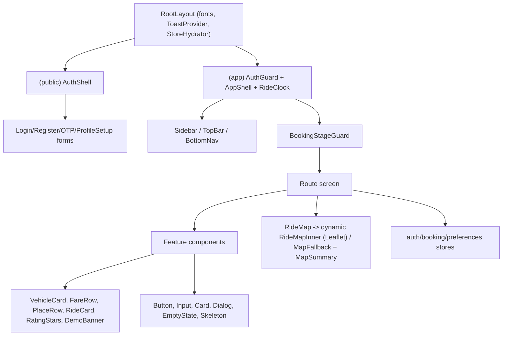

# E-GO Web Architecture (Implementation-Ready)

Status: **APPROVED by Orchestrator on 2026-11-15** with amendments recorded in `docs/web/ego_web_implementation_plan.md` (approved decisions A1–A14). Owner: Principal Architect.
Reconciliation: `docs/web/research_a_auth_ux.md`, `research_b_booking_map.md`, `research_c_rides_data.md` were produced in parallel; their verified findings are folded into the implementation plan. Where a screen-level detail is missing there, the Flutter source at `E-go/` remains authoritative for layout/copy, and the approved contracts in this document remain authoritative for web architecture.
Scope: greenfield Next.js app at `D:\E-RICKSHAW RIDE\E-go-web`; Flutter app at `E-go` is read-only reference.
Reconciliation inputs (parallel research, not yet consumed): `docs/web/research_a_auth_ux.md`, `docs/web/research_b_booking_map.md`, `docs/web/research_c_rides_data.md`. Where this doc and those docs disagree, this doc wins until orchestrator rules otherwise; each research doc gets a "Deviations" note in the PR.

---

## 1. Executive decisions

| # | Decision | Rationale |
|---|----------|-----------|
| D1 | Next.js 16.4.6 App Router, React 19.3.1, React DOM 19.3.1 | Current stable; App Router gives route groups, layouts, per-route loading/error. No Pages Router. |
| D2 | TypeScript pinned to `~5.9` (NOT 7.0.2) | `eslint-config-next@16` and several tooling peers cap TS below 6.1 today. TS 5.9 is the tested pairing; upgrading is a separate, isolated PR after the toolchain proves green. |
| D3 | Tailwind CSS 4.3.5 via `@tailwindcss/postcss`; **no `tailwind.config.js`** | v4 is CSS-first. Tokens live in `@theme` inside `app/globals.css`. One source of truth, no JS config drift. |
| D4 | Zustand 5.1.0 + `persist`, with `skipHydration: true` | App is 100% client-mocked auth; no server session. Explicit hydration avoids SSR mismatch. |
| D5 | Leaflet 1.9.4 + react-leaflet 5.0.0, dynamically imported with `ssr: false` | No API keys/cost, works offline-ish, React 19-compatible. Client-only keeps SSR clean. |
| D6 | Zod 4.6.7 at every trust boundary + `react-hook-form` 7.92.0 | One schema reused for forms, repository inputs, and persisted-data validation. |
| D7 | In-memory/localStorage mock behind repository interfaces; no real backend | Requirement is a demo web port with honest simulated labels. Interface lets a real API slot in later without touching screens. |
| D8 | No TanStack Query, no Redux, no Radix, no framer-motion | No server cache to manage yet; mock repos are local and synchronous-ish. Native `<dialog>` covers sheets/dialogs. CSS transitions cover motion. |
| D9 | Payments are mock-only; no card data fields beyond a masked label | Avoid collecting anything sensitive in a demo. "Add card" creates a fake masked entry. |
| D10 | Counts: 30 routes = 7 public/auth + 1 profile-setup + 22 protected app routes | Includes `/safety` (exists in Flutter, unrouted there) and `/about`. |
| D11 | Keep Flutter's `/profile-setup` concept (post-OTP name/email step) | Reuses proven copy/flow; avoids inventing an auth-success screen. |
| D12 | No edge middleware (`proxy.ts` in Next 16) for auth | Session lives in localStorage. A client guard + `returnTo` redirect is the only correct option. Cookie-backed sessions are a future-API concern. |
| D13 | Booking status is a single canonical enum used by both booking draft and ride lifecycle | Prevents two drifting enums; display labels are a separate map. |
| D14 | Timers are deadline-based (`nextTransitionAt` epoch), never tick-counted | Refresh/hidden-tab recovery works; simulation resumes correctly. |

### Dependency budget: install now

| Package | Version | Justification |
|---------|---------|---------------|
| `next` | `16.4.6` | Framework. |
| `react`, `react-dom` | `19.3.1` | Framework peer. |
| `typescript` (dev) | `~5.9` | See D2. |
| `@types/node` (dev) | Node-matching LTS line (`^24`) | Verify at install; only needed for config/tests. |
| `@types/react`, `@types/react-dom` (dev) | `^19` | TS types. |
| `tailwindcss`, `@tailwindcss/postcss` | `4.3.5` | Styling; versions must match. |
| `postcss` (dev) | `^8` | Required by Tailwind PostCSS plugin. |
| `zustand` | `5.1.0` | Client state + persist. |
| `zod` | `4.6.7` | Validation. |
| `react-hook-form` | `7.92.0` | Forms without re-render churn. |
| `@hookform/resolvers` | `^5` | Zod 4 resolver; verify peer at install. |
| `leaflet` | `1.9.4` | Map. |
| `react-leaflet` | `5.0.0` | React 19 bindings. |
| `@types/leaflet` (dev) | `^1.9` | TS types. |
| `clsx` + `tailwind-merge` | `^2` / `^3` | `cn()` helper; tailwind-merge v3 targets Tailwind 4. |
| `lucide-react` | current `^0.5xx` | Icon set; tree-shaken per icon, no icon font. |
| `vitest` (dev) | `5.1.0` | Unit tests. |
| `@vitejs/plugin-react` (dev) | `^5` | JSX for tests. |
| `jsdom` (dev) | `31.0.1` | DOM env. |
| `@testing-library/react` | `16.3.3` | Component tests (needs `@testing-library/dom` peer `^10`). |
| `@testing-library/dom`, `user-event`, `jest-dom` (dev) | `^10` / `^14` / `^6` | Peers + interaction + matchers. |
| `eslint` (dev) | `^9` (not 10) | `eslint-config-next` peer range is safest on 9 today. Attempting 10 is a separate spike. |
| `eslint-config-next` (dev) | `16.4.6` | Must match Next minor. |

### Deferred (do not install in batch 0)

| Package | When | Why deferred |
|---------|------|--------------|
| `@tanstack/react-query` | Only when a real HTTP API lands | Mock repos are local; Query would add cache/invalidation with zero benefit now. Repos return promises so the swap is trivial later. |
| `@playwright/test` | Batch 7, only with orchestrator approval | Heavy browser download; use installed Edge via `channel: 'msedge'`. |
| `@sentry/nextjs`, analytics | Production hardening | No backend, no DSNs, no consent UX yet. |
| `msw` | When API adapter tests exist | Overkill until `HttpAuthRepository` exists; use `vi.stubGlobal('fetch')` then. |
| `framer-motion` | Never, unless a spec'd animation can't be done in CSS | Native CSS transitions cover the needed polish. |
| `date-fns`, `uuid`, `axios`, `lodash` | Never | `Intl.DateTimeFormat`, `crypto.randomUUID()`, `fetch`, native array methods. |
| `@radix-ui/*`, `shadcn` CLI | Only if native `<dialog>` proves insufficient | Native dialog provides focus containment, Esc, and backdrop without JS deps. |
| `mapbox-gl`, Google Maps | Only if OSM tiles are rejected | Keys + billing + heavier bundle. |

**Explicitly rejected:** Redux Toolkit, Jotai/Recoil, NextAuth, Prisma, styled-components, Moment, next-themes (no dark mode requirement), icon fonts, `tailwind.config.js`.

### Windows / path notes
- Project path contains spaces: always quote paths in scripts. Prefer relative paths inside `package.json` scripts; no absolute paths in configs.
- Turbopack is the default dev/build bundler in Next 16. Leaflet is only reached via a dynamic client import, so no SSR bundling of `window`.
- `next.config.ts` uses async `headers()`? No; static headers object only. Keep config minimal: `reactStrictMode: true`, `typedRoutes: true`, `images.remotePatterns` only if remote avatars are introduced (currently none).

---

## 2. Feature-first folder tree

```
E-go-web/
  package.json
  next.config.ts
  tsconfig.json
  postcss.config.mjs
  eslint.config.mjs
  vitest.config.ts
  vitest.setup.ts
  .env.example
  README.md
  public/
    branding/ego_logo_primary.png        # copied from E-go/assets/branding
    branding/ego_logo_icon.png
    branding/ego_logo_wordmark.png
    branding/ego_brand_background.jpg
    licenses/OFL-Inter.txt
    licenses/OFL-Poppins.txt
  src/
    app/
      layout.tsx                         # html/body, fonts, providers, skip link
      globals.css                        # @import "tailwindcss" + @theme tokens + leaflet tweaks
      fonts.ts                           # next/font/local (Poppins, Inter)
      icon.png                           # from ego_logo_icon.png
      not-found.tsx
      error.tsx
      global-error.tsx
      loading.tsx
      page.tsx                           # / splash gate (client)
      (public)/
        layout.tsx                       # centered auth/marketing shell, no app nav
        onboarding/page.tsx
        onboarding-2/page.tsx
        onboarding-3/page.tsx
        login/page.tsx
        create-account/page.tsx
        otp/page.tsx                     # reads ?phone=
        profile-setup/page.tsx
      (app)/
        layout.tsx                       # AuthGuard + AppShell + RideClock + ToastHost
        loading.tsx
        error.tsx
        home/page.tsx
        pickup-selection/page.tsx
        destination-selection/page.tsx
        saved-places/page.tsx
        vehicle-selection/page.tsx
        fare-details/page.tsx
        booking-confirmation/page.tsx
        searching-driver/page.tsx
        driver-assigned/page.tsx
        ride-tracking/page.tsx
        trip-completed/page.tsx
        ride-rating/page.tsx
        my-rides/page.tsx
        ride-details/[id]/page.tsx
        profile/page.tsx
        edit-profile/page.tsx
        payment-methods/page.tsx
        notifications/page.tsx
        help-support/page.tsx
        settings/page.tsx
        about/page.tsx
        safety/page.tsx
    components/
      ui/            button.tsx icon-button.tsx input.tsx textarea.tsx otp-input.tsx
                     card.tsx badge.tsx avatar.tsx dialog.tsx sheet.tsx skeleton.tsx
                     empty-state.tsx error-state.tsx spinner.tsx stepper.tsx
                     segmented-tabs.tsx toast.tsx field.tsx
      layout/        app-shell.tsx sidebar.tsx bottom-nav.tsx top-bar.tsx page-header.tsx
                     container.tsx auth-shell.tsx
      shared/        logo.tsx status-pill.tsx fare-row.tsx vehicle-card.tsx place-row.tsx
                     ride-card.tsx rating-stars.tsx demo-banner.tsx screen-guard.tsx
      map/           ride-map.tsx (dynamic wrapper) ride-map-inner.tsx map-fallback.tsx
                     map-summary.tsx marker-icons.ts
    features/
      auth/          components/login-form.tsx register-form.tsx otp-form.tsx
                     profile-setup-form.tsx; hooks/use-auth-redirect.ts
      onboarding/    components/onboarding-slide.tsx; content.ts
      booking/       components/place-search.tsx pickup-form.tsx destination-form.tsx
                     saved-place-list.tsx vehicle-list.tsx fare-card.tsx booking-summary.tsx
                     searching-panel.tsx driver-card.tsx ride-progress.tsx trip-receipt.tsx
                     rating-form.tsx cancel-ride-dialog.tsx
      rides/         components/ride-history-list.tsx ride-detail-panel.tsx
      profile/       components/profile-form.tsx payment-method-list.tsx
      settings/      components/settings-toggles.tsx notifications-list.tsx
      support/       components/faq-list.tsx safety-panel.tsx
    lib/
      domain/        types.ts schemas.ts booking-fsm.ts fare.ts geo.ts labels.ts
                     ride-orchestrator.ts errors.ts result.ts
      repositories/  types.ts index.ts auth-repository.ts ride-repository.ts
                     places-repository.ts profile-repository.ts payment-repository.ts
                     notification-repository.ts http/ (future adapters; empty in batch 0)
      mock/          db.ts seeds.ts auth-mock.ts ride-mock.ts places-mock.ts
                     payment-mock.ts notification-mock.ts simulation.ts
      config/        env.ts constants.ts
      utils/         cn.ts format.ts phone.ts id.ts storage.ts
    stores/
      auth-store.ts booking-store.ts preferences-store.ts store-hydrator.tsx
      selectors.ts
    styles/          tokens.css? (optional split; default keep in globals.css)
  tests/
    unit/            booking-fsm.test.ts fare.test.ts phone.test.ts schemas.test.ts
                     ride-orchestrator.test.ts env.test.ts
    repositories/    auth-repository.test.ts ride-repository.test.ts
    components/      login-form.test.tsx vehicle-list.test.tsx fare-card.test.tsx
                     rating-form.test.tsx auth-guard.test.tsx empty-states.test.tsx
    fixtures/        rides.ts places.ts drivers.ts
  e2e/               booking.spec.ts (optional, batch 7)
```

Ownership rule: only one developer owns a file at a time. Batches below assign directories, not individual files, except shared `src/lib/domain/*` and `src/app/globals.css`, which are frozen after their batch unless the architect approves a change.
---

## 3. Web route map and protection

30 routes total: **7 public/auth + 1 session-with-incomplete-profile + 22 protected app routes**. One alias is a redirect, not a screen: `/register` -> `/create-account` (Flutter maps both to the same widget); aliases are excluded from the count.

### Public group `(public)` - centered shell, no app navigation

| Route | Screen | Entry rules / params |
|-------|--------|----------------------|
| `/` | Splash + routing gate | Onboarding not seen -> `/onboarding`; else session -> `/home`; else `/login`. Renders brand mark, hard maximum 600 ms visual; redirect uses `router.replace`. |
| `/onboarding` | Onboarding 1/3 | Skip and Continue both mark `onboardingSeen`. A visible "1 of 3" progress. |
| `/onboarding-2` | Onboarding 2/3 | Direct deep link allowed; back goes to `/onboarding`. |
| `/onboarding-3` | Onboarding 3/3 | CTA -> `/create-account`; secondary "I already have an account" -> `/login`. |
| `/login` | Login | `?returnTo=` optional; demo credentials card visible only when demo mode is on. Success -> profile complete ? `returnTo ?? /home` : `/profile-setup`. |
| `/create-account` | Create account | `?returnTo=`. Success -> `/otp?phone=...&returnTo=...`. |
| `/otp` | OTP verification | `phone` query is mandatory; missing/invalid -> `replace('/login')`. OTP is never placed in the URL. 30 s resend cooldown. Success -> `/profile-setup` (new) or `returnTo` (returning). |
| `/profile-setup` | Auth success / profile setup | Requires a session; if none -> `/login?returnTo=/profile-setup`. If profile already complete -> `/home`. Keeps Flutter's route name (D11). |

### Protected group `(app)` - app shell, sidebar on desktop, bottom nav on mobile

| Route | Guard (booking stage) | Params / notes |
|-------|----------------------|----------------|
| `/home` | auth | Greeting, active-ride banner if one exists, quick actions, recent rides. |
| `/pickup-selection` | auth; booking `idle` or `selectingPickup` | Search + saved places + map tap. Selecting sets pickup and moves to `selectingPickup`. |
| `/destination-selection` | pickup present; status `selectingPickup` or `selectingDestination` | Missing pickup -> `/pickup-selection`. |
| `/saved-places` | auth | `?mode=manage` (default, full page) or `?mode=select&for=pickup|destination` (returns selected place via store and back). |
| `/vehicle-selection` | pickup + destination; status `selectingDestination` or `selectingVehicle` | Two vehicle cards with computed fare/ETA. |
| `/fare-details` | vehicle selected; status `selectingVehicle` or `reviewingFare` | Full breakdown, tolls = 0, platform fee shown separately. |
| `/booking-confirmation` | status `reviewingFare` or `confirmingBooking` | Payment method chooser, demo notice, confirm button. |
| `/searching-driver` | active ride exists; status `searchingDriver` | Cancel and retry paths. Never reachable with status terminal. |
| `/driver-assigned` | status `driverAssigned` or `driverArriving` | Driver card, OTPless demo, call/message are simulated (toast). |
| `/ride-tracking` | status `driverArriving`, `driverArrived`, or `tripInProgress` | Full map + progress. |
| `/trip-completed` | status `tripCompleted` or `awaitingRating` | Receipt, payment method, CTA to rate. |
| `/ride-rating` | status `awaitingRating`, or `?rideId=` for an unrated historical ride | Stars 1-5 required; comment optional. Submit -> `rated` -> `/my-rides`. "Not now" -> `rated` with no rating. |
| `/my-rides` | auth | Tabs All / Completed / Cancelled; empty state. |
| `/ride-details/[id]` | auth | Flutter passes a `RideRecord` object; web passes the id in the path (deep-linkable). Unknown id -> in-page `EmptyState` with link to `/my-rides` (not a bare 404). |
| `/profile` | auth | Read-only summary + links. |
| `/edit-profile` | auth | Name/email/avatar initials; phone read-only. |
| `/payment-methods` | auth | Mock cash/UPI/card entries; add/remove/default. |
| `/notifications` | auth | Mock notifications, unread badge, mark all read. |
| `/help-support` | auth | FAQ accordion + simulated contact actions. |
| `/settings` | auth | Preferences, logout, clear demo data, version. |
| `/about` | auth | Product/legal/demo disclaimers. |
| `/safety` | auth | Safety tools (share trip simulated, emergency contacts, helplines). Routed here even though Flutter leaves it unrouted. |

### Protection strategy (client-only, D12)

1. `StoreHydrator` (client, mounted once in root layout) calls `persist.rehydrate()` for auth/booking/preferences/mock DB and sets `hasHydrated`. **Nothing reads storage during render or module scope.**
2. `AuthGuard` inside `(app)/layout.tsx`:
   - `!hasHydrated` -> full-page skeleton (no redirect yet, prevents flash).
   - no session or expired session -> `router.replace('/login?returnTo=' + encodeURIComponent(pathname + search))`.
   - session but `!user.profileComplete` -> `router.replace('/profile-setup')`.
   - renders `AppShell` only when both pass.
3. `BookingStageGuard` (shared, wraps each booking page) uses a static `ROUTE_STAGE_RULES` map. On mismatch it redirects to the earliest unmet prerequisite (`/pickup-selection` -> `/destination-selection` -> `/vehicle-selection`) with a one-line toast. Uses `replace` to avoid back-button loops.
4. `sanitizeReturnTo(raw)`: accept only internal paths beginning with a single `/`, reject `//`, `\`, `:`, protocol-relative and absolute URLs, cap 300 chars, allowlist first segment (`home|pickup-selection|...|settings`). Fallback `/home`. Unit-tested.
5. Session expiry: `AuthSession.expiresAt` checked at hydration and on each guard render; expired -> clear session, keep mock DB, redirect to login with `returnTo`.
6. Logout: clear auth session + active booking draft/ride pointer; keep ride history and saved places; `router.replace('/login')`.

### Refresh recovery and deep links

- Persisted ride carries `status`, `phaseStartedAt`, `nextTransitionAt`, `timeline[]`.
- On hydration, `resumeRide(ride, now)` advances the FSM using elapsed time, at most 8 steps per pass, emitting each timeline event once. Terminal statuses are finalized (rating pending stays `awaitingRating`).
- If the persisted ride fails Zod validation, discard it, keep history, log a dev-only warning, land on `/home`.
- Deep links to booking stages without prerequisites redirect (they are state-dependent by design). `/ride-details/[id]` and `/my-rides` are fully deep-linkable.
- `?rideId=` is only used for rating a historical ride; it is validated against the DB.

### Error and not-found boundaries

- `app/not-found.tsx`: brand-consistent 404 with "Go home".
- `app/global-error.tsx`: minimal inline-styled fatal screen (cannot rely on Tailwind being loaded).
- `app/error.tsx` and `app/(app)/error.tsx`: retry via `reset()`, "Back to home", dev-only error digest.
- `app/loading.tsx` inside `(app)`: skeleton shell. `my-rides` and `ride-details` have route-level skeletons.
- Suspense: any page using `useSearchParams` is wrapped in `<Suspense>` to keep prerender valid in Next 16.

---

## 4. Domain model

Canonical types in `src/lib/domain/types.ts`, Zod schemas in `src/lib/domain/schemas.ts` (schemas mirror types via `z.infer` so there is one truth per entity). Money is integer rupees (`number`), never floats. Coordinates are `number` lat/lng. IDs are strings (`crypto.randomUUID()`).

```ts
export const VEHICLE_TYPES = ['bike', 'toto'] as const;
export type VehicleType = (typeof VEHICLE_TYPES)[number];

export const BOOKING_STATUSES = [
  'idle', 'selectingPickup', 'selectingDestination', 'selectingVehicle',
  'reviewingFare', 'confirmingBooking', 'searchingDriver', 'driverAssigned',
  'driverArriving', 'driverArrived', 'tripInProgress', 'tripCompleted',
  'awaitingRating', 'rated', 'cancelled', 'failed',
] as const;
export type BookingStatus = (typeof BOOKING_STATUSES)[number];
export type RideStatus = BookingStatus; // single canonical enum (D13)

export type PaymentMethodType = 'cash' | 'upi' | 'card' | 'wallet';

export interface LatLng { lat: number; lng: number }
export interface Place extends LatLng {
  id: string; label: string; address: string;
  kind: 'pickup' | 'destination' | 'saved' | 'poi';
}
export interface SavedPlace extends Place {
  savedId: string; tag: 'home' | 'work' | 'other';
}
export interface User {
  id: string; fullName: string; phone: string; email?: string;
  avatarUrl?: string; profileComplete: boolean; createdAt: string; // ISO
}
export interface AuthSession {
  userId: string; token: string; issuedAt: string; expiresAt: string;
}
export interface VehicleOption {
  type: VehicleType; name: string; description: string;
  capacity: number; estimatedArrivalMinutes: number; fare: number;
}
export interface FareBreakdown {
  vehicle: VehicleType; baseFare: number; distanceFare: number;
  platformFee: number; total: number; distanceKm: number; // display: 1 decimal
  estimatedMinutes: number; estimatedArrivalMinutes: number; currency: 'INR';
}
export interface Driver {
  id: string; name: string; rating: number; ridesCompleted: number;
  vehicleType: VehicleType; vehicleModel: string; vehicleNumber: string;
  location: LatLng; etaMinutes: number;
}
export interface Rating {
  rideId: string; stars: 1 | 2 | 3 | 4 | 5; comment?: string;
  tags: string[]; createdAt: string;
}
export interface PaymentMethod {
  id: string; type: PaymentMethodType; label: string; masked?: string;
  isDefault: boolean;
}
export interface Ride {
  id: string; userId: string; pickup: Place; destination: Place;
  vehicle: VehicleType; fare: FareBreakdown; status: RideStatus;
  driver?: Driver; paymentMethodId: string;
  createdAt: string; phaseStartedAt: string; nextTransitionAt?: string;
  completedAt?: string; cancelledAt?: string;
  cancellationReason?: CancellationReason;
  rating?: Rating;
  timeline: { status: RideStatus; at: string }[];
}
export interface BookingDraft {
  pickup?: Place; destination?: Place; vehicle?: VehicleType;
  fare?: FareBreakdown; paymentMethodId?: string;
}
export interface AppNotification {
  id: string; kind: 'ride' | 'payment' | 'promo' | 'system';
  title: string; body: string; createdAt: string; read: boolean;
}
export type CancellationReason =
  | 'driver_too_far' | 'waiting_too_long' | 'changed_plan' | 'other';
export type AppErrorCode =
  | 'invalid_phone' | 'invalid_otp' | 'otp_expired' | 'otp_cooldown'
  | 'invalid_credentials' | 'account_exists' | 'not_found'
  | 'invalid_transition' | 'storage_corrupt' | 'demo_disabled' | 'unknown';
```

Zod rules (all in `schemas.ts`):

| Schema | Rules |
|--------|-------|
| `phoneSchema` | Port exactly: strip non-digits; if 12 digits starting `91`, drop 2; else if 11 starting `0`, drop 1; then `^[6-9]\d{9}$`; return E.164 `+91XXXXXXXXXX`. |
| `otpSchema` | exactly 6 digits, `.regex(/^\d{6}$/)`; mock accepts `123456` only in demo mode. |
| `passwordSchema` | Registration: >= 8 chars and not whitespace-only. Login: any non-empty input (repository decides), matching Flutter. Registered accounts still authenticate by OTP; password is never persisted. |
| `latLngSchema` | lat -90..90, lng -180..180, finite. |
| `placeSchema` | id/label/address non-empty, kind enum, coordinates. |
| `fareBreakdownSchema` | integers >= 0; `total === base + distance + platform`; `distanceKm >= 0.5`; `distanceFare` is the rounded value used in `total`. |
| `ratingSchema` | stars int 1..5, comment max 300, tags max 5. |
| `rideSchema` | full Ride; `status` enum; timeline non-empty; nullable driver; `superRefine` for terminal consistency (`completedAt` iff completed/awaitingRating/rated; `rating` only when rated). |
| `persistedRideSchema` | `rideSchema` + `schemaVersion` literal. |
| `userSchema` / `sessionSchema` | ISO datetimes via `z.iso.datetime()` (Zod 4), phone via `phoneSchema`, session expiry > issuedAt. |

Persistence uses `safeParse`; invalid data is discarded rather than crashing.

Fare port rule: `effectiveDistance = max(0.5, haversineKm)`; bike `distanceFare = round(effectiveDistance * 10)`, toto `round(effectiveDistance * 7)`; ETA `round(effectiveDistance / 20 * 60 + 3).clamp(2,60)` (bike) and `round(effectiveDistance / 12 * 60 + 5).clamp(3,90)` (toto); arrival 3 / 5 min. `distanceKm` is rounded to 1 decimal for display only; `total` uses the rounded `distanceFare` exactly as Flutter does. Dart `toStringAsFixed(0)` and JS `Math.round` agree for these positive values.

### Booking FSM - exact transition table

`src/lib/domain/booking-fsm.ts`:

```ts
export const TRANSITIONS: Record<BookingStatus, readonly BookingStatus[]> = {
  idle:                ['selectingPickup', 'selectingDestination', 'selectingVehicle'],
  selectingPickup:     ['idle', 'selectingDestination', 'selectingVehicle'],
  selectingDestination:['idle', 'selectingPickup', 'selectingVehicle'],
  selectingVehicle:    ['selectingDestination', 'reviewingFare', 'confirmingBooking', 'idle'],
  reviewingFare:       ['selectingVehicle', 'confirmingBooking', 'idle'],
  confirmingBooking:   ['reviewingFare', 'searchingDriver', 'idle'],
  searchingDriver:     ['driverAssigned', 'failed', 'cancelled', 'idle'],
  driverAssigned:      ['driverArriving', 'cancelled'],
  driverArriving:      ['driverArrived', 'cancelled'],
  driverArrived:       ['tripInProgress', 'cancelled'],
  tripInProgress:      ['tripCompleted'],
  tripCompleted:       ['awaitingRating'],
  awaitingRating:      ['rated', 'idle'],
  rated:               ['idle'],
  cancelled:           ['idle'],
  failed:              ['idle', 'searchingDriver'],
};
```

This map is a **line-for-line port** of `E-go/lib/core/booking_state.dart` (`_allowedTransitions`). Do not "improve" it: there is deliberately no cancel edge from `tripInProgress`, `tripCompleted` only goes to `awaitingRating`, skipping a rating goes to `idle`, and the early selection steps may jump straight to `selectingVehicle`/`confirmingBooking`.

| From | Allowed next | Server/pure effects |
|------|--------------|---------------------|
| `idle` | `selectingPickup`, `selectingDestination`, `selectingVehicle` | New draft; archive any terminal active ride first. |
| `selectingPickup` | `idle`, `selectingDestination`, `selectingVehicle` | Persist pickup; back discard allowed. |
| `selectingDestination` | `idle`, `selectingPickup`, `selectingVehicle` | Persist destination; back keeps pickup. |
| `selectingVehicle` | `selectingDestination`, `reviewingFare`, `confirmingBooking`, `idle` | Compute both quotes on entry; direct confirm stays legal for parity. |
| `reviewingFare` | `selectingVehicle`, `confirmingBooking`, `idle` | Fare breakdown becomes `draft.fare`. |
| `confirmingBooking` | `reviewingFare`, `searchingDriver`, `idle` | Create ride, assign driver id, schedule search. No failure edge here. |
| `searchingDriver` | `driverAssigned`, `failed`, `cancelled`, `idle` | 8 s window; retry only via `failed` -> `searchingDriver`. |
| `driverAssigned` | `driverArriving`, `cancelled` | 4 s; notification event. |
| `driverArriving` | `driverArrived`, `cancelled` | 14 s; live ETA countdown. |
| `driverArrived` | `tripInProgress`, `cancelled` | Rider taps "Start trip"; 90 s auto-start fallback. |
| `tripInProgress` | `tripCompleted` | 20 s simulated progress; no rider cancel edge (safety/support copy only). |
| `tripCompleted` | `awaitingRating` | Receipt + history write (idempotent by ride id). |
| `awaitingRating` | `rated`, `idle` | Rating saved to ride/history; skip -> `idle`. |
| `rated` | `idle` | Reset draft, keep history. |
| `cancelled` | `idle` | Cancelled ride appended to history once. |
| `failed` | `idle`, `searchingDriver` | "Try again" re-enters searching with the same draft. |

Every transition goes through `transition(ride|draft, to)` which throws/returns `{ ok:false, error:'invalid_transition' }`. Store actions never set `status` directly. Tests assert the full matrix (all 16 rows x all 16 targets) is exactly as above, and that no action bypasses the map.

### Orchestration design

- `booking-store.ts` holds `draft`, `activeRide`, `lastError`, and actions: `startBooking`, `choosePickup`, `chooseDestination`, `chooseVehicle`, `reviewFare`, `confirmBooking`, `cancelBooking(reason)`, `startTrip`, `completeTrip`, `submitRating`, `skipRating`, `retrySearch`, `resetBooking`, `tick(now)`.
- `confirmBooking` computes fare through `lib/domain/fare.ts`, creates the `Ride` via `rideRepository.create()`, sets `searchingDriver` with `nextTransitionAt = now + 8000`.
- `tick(now)` is the only timer entry point. It is idempotent: if `now < nextTransitionAt` return; otherwise perform exactly one scheduled transition, append a timeline event, and schedule the next. `tick` is called from one `RideClock` component (1 s interval) mounted in `(app)/layout`, plus once on `visibilitychange` and once after hydration.
- `lib/domain/ride-orchestrator.ts` is pure and framework-free: `scheduleNextTransition(ride, now)`, `advance(ride, now)`, `resumeRide(ride, now)`, `finalizeIfTerminal(ride)`. Tests use explicit timestamps, no real timers.
- Guards live in the store (`canTransition`), and the router guard lives in `BookingStageGuard`; they must not duplicate transition logic, only route eligibility.
- Simulation randomness is confined to `lib/mock/simulation.ts` (driver pick, optional search failure rate default 0 so deterministic demos). `NEXT_PUBLIC_SIM_SEED` may seed it for e2e. Failures surface only during `searchingDriver` because that is the only edge to `failed`.
- Cancellation is allowed only from the four live edges in the table (`searchingDriver`, `driverAssigned`, `driverArriving`, `driverArrived`); it is blocked in `tripInProgress` and all later/terminal states. Cancellation reasons drive the copy.
---

## 5. State ownership

| Concern | Owner | Persisted | Notes |
|---------|-------|-----------|-------|
| User, session, `onboardingSeen`, `profileComplete` | `auth-store` | `ego:auth:v1` | Session contains mock token + expiry. |
| Booking draft, active ride, status, timers | `booking-store` | `ego:booking:v1` | Status only changes through FSM actions. |
| Mock database (accounts, rides, saved places, payment methods, notifications) | `lib/mock/db.ts` behind repositories | `ego:db:v1` | Synchronous localStorage read/write wrapped in Promises; no Zustand needed. Rides are also referenced by the booking store for the active trip. |
| Preferences (notification toggles, reduced motion override) | `preferences-store` | `ego:prefs:v1` | Small, separate so auth reset does not wipe settings. |
| Form values/errors/touched | `react-hook-form` local | No | Schemas from `lib/domain/schemas.ts`. |
| Search text, active tab, dialog open, selected card | Component `useState` | No | Never lift unless two routes need it. |
| Toasts | `ToastProvider` context | No | `aria-live="polite"`, max 3 stacked. |
| Hydration flags | stores (`hasHydrated`) | No | Gate guards/skeletons; set by `StoreHydrator`. |
| Map instance/markers | Leaflet refs inside client map | No | Recreated on mount. |

Rules:
- No server state today. All data comes from repositories (which read the mock DB). Do **not** cache repository results in Zustand; screens fetch on mount so history/rating stays fresh.
- **TanStack Query trigger:** when `HttpAuthRepository`/`HttpRideRepository` land. Then queries keyed `['rides', userId]`, `['ride', id]`, `['saved-places', userId]`, `['notifications', userId]`; mutations for rating/cancel/save-place with optimistic updates; auth stays in Zustand. Deferring is justified because the current data source is local and has no invalidation/staleness semantics.
- Hydration safety: `skipHydration: true` on all persisted stores; `StoreHydrator` runs `rehydrate()` in an effect, then sets `hasHydrated`. No storage access in render, module scope, or server components. Relative times ("2 min ago") and `Date.now()`-derived values render only after mount. Booking screens read the store only after `hasHydrated`, otherwise skeleton.
- Multi-tab: listen to `storage` events for auth/booking; if another tab logs out, clear local session and redirect to login (no merge conflict resolution).

Persistence keys, versions, and recovery:

| Key | Version | Content | On corrupt/unknown version |
|-----|---------|---------|----------------------------|
| `ego:auth:v1` | 1 | `{session,user,onboardingSeen}` | Clear auth only; show login (onboarding flag defaults to seen to avoid loops). |
| `ego:booking:v1` | 1 | `{draft,activeRide,schemaVersion}` | Discard booking, land `/home`; history untouched. |
| `ego:db:v1` | 1 | `{accounts,rides,savedPlaces,paymentMethods,notifications,schemaVersion}` | Reset mock DB to seeds. |
| `ego:prefs:v1` | 1 | `{notifications, reducedMotion}` | Defaults. |

- `schemaVersion` is a literal in each persisted payload; migrations live in `lib/utils/storage.ts` (`migrate(key, raw)`), one function per key with explicit `from -> to` steps. Unknown future version -> archive under `ego:legacy:<key>:<ts>` and initialize fresh.
- Quota/exception handling: catch `QuotaExceededError`/`SecurityError`; keep the current in-memory state, show one toast ("Demo data could not be saved"), disable persistence for the tab.
- Clear demo data (Settings) removes all `ego:*` keys and reloads; logout removes `ego:auth:v1` and `ego:booking:v1` only.

---

## 6. Repositories, auth abstraction, environment

`lib/repositories/types.ts`:

```ts
export type Result<T> = { ok: true; data: T } | { ok: false; error: AppError };
export interface AppError { code: AppErrorCode; message: string; field?: string }

export interface AuthRepository {
  requestOtp(phone: string): Promise<Result<{ cooldownSeconds: number }>>;
  verifyOtp(phone: string, code: string): Promise<Result<{ user: User; session: AuthSession; isNewUser: boolean }>>;
  login(phone: string, password: string): Promise<Result<{ user: User; session: AuthSession }>>;
  register(input: { fullName: string; phone: string; email?: string; password: string }): Promise<Result<{ phone: string }>>;
  updateProfile(userId: string, patch: Partial<Pick<User, 'fullName' | 'email' | 'avatarUrl'>>): Promise<Result<User>>;
  logout(): Promise<Result<null>>;
}
export interface RideRepository {
  create(input: { userId: string; pickup: Place; destination: Place; vehicle: VehicleType; fare: FareBreakdown; paymentMethodId: string }): Promise<Result<Ride>>;
  save(ride: Ride): Promise<Result<Ride>>;           // orchestrator persistence
  getActive(userId: string): Promise<Result<Ride | null>>;
  getById(rideId: string): Promise<Result<Ride>>;
  list(userId: string, filter?: 'all' | 'completed' | 'cancelled'): Promise<Result<Ride[]>>;
  cancel(rideId: string, reason: CancellationReason): Promise<Result<Ride>>;
  rate(rideId: string, rating: Rating): Promise<Result<Ride>>;
}
export interface PlacesRepository {
  search(query: string): Promise<Result<Place[]>>;
  listSaved(userId: string): Promise<Result<SavedPlace[]>>;
  save(userId: string, place: Place, tag: SavedPlace['tag']): Promise<Result<SavedPlace>>;
  remove(userId: string, savedId: string): Promise<Result<null>>;
}
export interface PaymentRepository {
  list(userId: string): Promise<Result<PaymentMethod[]>>;
  add(userId: string, method: Omit<PaymentMethod, 'id'>): Promise<Result<PaymentMethod>>;
  remove(userId: string, id: string): Promise<Result<null>>;
  setDefault(userId: string, id: string): Promise<Result<PaymentMethod[]>>;
}
export interface NotificationRepository {
  list(userId: string): Promise<Result<AppNotification[]>>;
  markRead(userId: string, id: string): Promise<Result<AppNotification[]>>;
  markAllRead(userId: string): Promise<Result<AppNotification[]>>;
}
```

Implementation rules:
- All user-facing auth/validation/error copy is centralized in `lib/domain/labels.ts` (seeded from the Flutter strings; research_a reconciles wording) so tests can assert exact text. Repos validate inputs/outputs with Zod, simulate 150-400 ms latency (`mockDelay()`), and never throw for expected failures; return `Result`.
- Mock implementations live in `lib/mock/*` and own all `ego:db:v1` reads/writes. Screens/auth store import only `getRepositories()`, never `lib/mock` directly (the map/clock may import `lib/domain`).
- `lib/repositories/index.ts` chooses adapters from `env.useMockApi`. `lib/repositories/http/` is created empty in batch 0 with a README and one stub each, so the swap is additive: constructor takes `baseUrl` + `fetchImpl`, maps HTTP errors to `AppError`.
- Auth abstraction: screens call `useAuthStore` actions only; the store calls `AuthRepository`. Swapping to a real API later means changing one factory function plus adding cookie/session strategy, not screen code.

Environment (`lib/config/env.ts`, parsed with Zod, all public):
| Variable | Default | Purpose |
|----------|---------|---------|
| `NEXT_PUBLIC_ENABLE_DEMO_AUTH` | `false` (`.env.local` sets `true`) | Enables demo login/OTP. |
| `NEXT_PUBLIC_API_BASE_URL` | empty | Future HTTP adapters. |
| `NEXT_PUBLIC_MAP_TILE_URL` | OSM template | Tile provider override. |
| `NEXT_PUBLIC_DISABLE_MAP` | `false` | Fallback-only mode for CI/e2e. |
| `NEXT_PUBLIC_SIM_SEED` | empty | Deterministic simulation. |

- `isDemoAuthEnabled = env.NEXT_PUBLIC_ENABLE_DEMO_AUTH === 'true' && process.env.NODE_ENV !== 'production'` (the second condition is compiled out in prod). Demo credentials and OTP `123456` live in `lib/mock/demo-credentials.ts`, imported lazily inside the mock auth repository; login screen checks `isDemoAuthEnabled` before showing the credentials card. Batch 7 adds a build check: `grep` the `.next/static` output for `EgoDemo@123` and fail if found with demo disabled.
- No secrets. No `NEXT_PUBLIC_*` value may ever be treated as private. `.env.example` documents each variable; `.env.local` is gitignored.
- Registered mock accounts are OTP-only: the password is validated (>= 8) and discarded, never stored. Password login is demo-account-only, stated in UI copy.

---

## 7. Map architecture

- **Files:** `components/map/ride-map.tsx` (client wrapper + `next/dynamic`), `ride-map-inner.tsx` (imports Leaflet, all map code), `map-fallback.tsx`, `map-summary.tsx`, `marker-icons.ts`.
- **Loading:** `dynamic(() => import('./ride-map-inner'), { ssr: false, loading: <MapSkeleton/> })`. `ssr:false` is legal because the wrapper is a client component. Leaflet never enters the server bundle and never sees `window` during prerender.
- **CSS:** `import 'leaflet/dist/leaflet.css'` inside `ride-map-inner.tsx` so it ships only with the map chunk. In `globals.css` set `.leaflet-container { z-index: 0; background: var(--color-surface); font: inherit; }` to prevent map panes covering the sticky header/sheets. Do not import Leaflet CSS in the root layout (avoids unused CSS on auth screens).
- **Tiles:** default `https://{s}.tile.openstreetmap.org/{z}/{x}/{y}.png`, `maxZoom: 19`, `attribution` HTML `&copy; <a href="https://www.openstreetmap.org/copyright">OpenStreetMap</a> contributors`. Overridable via env. OSM usage policy forbids heavy/commercial traffic: production must switch providers (open question R4).
- **Markers:** `L.divIcon` HTML/CSS dots (pickup: yellow fill, navy 3px ring; destination: navy fill, white ring; driver: navy pill with "T" or bike glyph). Avoids the broken default-icon PNG path in bundlers. Sizes 32x32, anchor centered, `aria-hidden` on decorative markers.
- **Polyline:** dashed navy (`color #142B45`, `weight 4`, `dashArray '6 8'`, `opacity .75`) labelled "Approx. route - simulated". Single straight segment; no routing service is called.
- **Camera:** center 22.4529, 86.9003 (Jhargram); mock current location 22.4550, 86.9020. `fitBounds` with 48 px padding when both pickup and destination exist, else center on available point, zoom 14. `scrollWheelZoom={false}` on mobile, `true` on desktop via `useMediaQuery`.
- **Selection UX:** search list is the primary selector (`/pickup-selection`, `/destination-selection`), saved places second. Map tap resolves to the nearest seeded POI (mock reverse geocode) and shows a confirm bar ("Use this location"). This avoids a geocoding API while keeping the map interactive.
- **Layout:** mobile - map 34vh, sticky, with the search/sheet card overlapping below; desktop (`lg`) - 7/5 grid, map sticky and full column height, panel scrolls independently. Tracking screen: same split with driver ETA panel; mobile shows map 45vh plus a draggable sheet.
- **Failure:** class `MapErrorBoundary` catches render errors; tile `tileerror` counter >= 3 switches to `MapFallback` (CSS/SVG static diagram + "Map unavailable - showing locations"). Offline detection via `navigator.onLine` plus the counter. No retry loop storms; a manual "Try map again" re-mounts once.
- **Accessibility/testing:** `MapSummary` renders text (pickup/destination labels, distance, ETA) both visually in fallback and `sr-only` when the map works; map container gets `role="application"`? No - use `aria-label="Map showing pickup and destination"` on a labelled region, and `aria-hidden` on the Leaflet pane. Set `NEXT_PUBLIC_DISABLE_MAP=true` in Vitest and Playwright; tests assert the summary and never mount Leaflet.

---

## 8. Design system implementation

**Tailwind v4 configuration:** `postcss.config.mjs` registers `@tailwindcss/postcss` only. `globals.css` starts with `@import "tailwindcss";` then an `@theme` block. No `tailwind.config.js/ts`; any attempt to add one is rejected (D3). Component classes use semantic utilities (`bg-brand`, `text-navy`, `rounded-card`) generated from tokens.

```css
@import "tailwindcss";
@theme {
  --color-brand: #FFC928;
  --color-brand-strong: #E6B31E;   /* pressed/hover only */
  --color-surface: #F5F7FA;
  --color-navy: #142B45;
  --color-ink: #0F1D2B;
  --color-muted: #5B6B7C;
  --color-line: #E2E8F0;
  --color-success: #1F9D61;
  --color-danger: #C93C3C;
  --radius-card: 16px;
  --radius-pill: 9999px;
  --font-sans: var(--font-inter), ui-sans-serif, system-ui, sans-serif;
  --font-display: var(--font-poppins), var(--font-inter), sans-serif;
  --shadow-card: 0 8px 24px rgb(20 43 69 / 0.08);
}
```

- **Spacing:** Tailwind default 4 px scale; every layout dimension is a multiple of 4. Page gutters 16 mobile / 24 tablet / 32 desktop. Container `max-w-[1200px] mx-auto`.
- **Buttons:** pill radius, heights 48 (`h-12`) default and 56 (`h-14`) primary; full-width on mobile, inline on desktop. Min hit area 44x44. Disabled = 45% opacity + `cursor-not-allowed`, no hover transform.
- **Cards/inputs:** `rounded-card` (16 px), `border-line`, white surface, `shadow-card` on elevated cards only. Inputs 52 px tall, 16 px label above, error text 14 px danger with `aria-describedby`.
- **Fonts:** copy `Poppins-{Regular,Medium,SemiBold,Bold,ExtraBold}.ttf` and `Inter-{Regular,Medium,SemiBold,Bold}.ttf` into `src/assets/fonts/{poppins,inter}/`; license texts into `public/licenses/`. `app/fonts.ts` uses `next/font/local` per file with explicit `weight`/`style`, `display: 'swap'`, CSS variables `--font-poppins`/`--font-inter`, `preload: true` only for Poppins SemiBold/Bold and Inter Regular/Medium. Manrope and unused weights are not copied. Poppins 600/700/800 for headings and fares; Inter 400-700 for body. Do not use `@font-face` by hand.
- **Assets:** copy the 5 branding files to `public/branding/`; `app/icon.png` from `ego_logo_icon.png`; logos via `next/image` with explicit dimensions and `alt` ("E-GO"), decorative background `ego_brand_background.jpg` only on onboarding slide 1 with `priority`, everything else lazy. No image CDN.
- **Breakpoints:** default Tailwind - `sm 640`, `md 768`, `lg 1024`, `xl 1280`. App shell switches at `lg`. Desktop layouts are intentionally designed: sidebar + 2-column content or 7/5 map split, never centered stretched mobile cards. Tables (my rides) appear at `md+`, cards below.

| Inventory | Components |
|-----------|------------|
| `ui/` | `Button`, `IconButton`, `Input`, `Textarea`, `OtpInput`, `Field`, `Card`, `Badge`, `Avatar` (initials fallback), `Dialog`/`Sheet` (native `<dialog>` + backdrop, focus restore), `Skeleton`, `EmptyState`, `ErrorState`, `Spinner`, `Stepper`, `SegmentedTabs`, `Toast` |
| `layout/` | `AppShell` (sidebar `lg+`, top bar, bottom nav `lg-`), `Sidebar`, `BottomNav`, `TopBar`, `PageHeader`, `Container`, `AuthShell` |
| `shared/` | `Logo`, `StatusPill`, `FareRow`, `VehicleCard`, `PlaceRow`, `RideCard`, `RatingStars`, `DemoBanner`, `ScreenGuard` |
| Features | per-feature components listed in the tree (forms, map panels, receipt, safety) |

**Accessibility baseline (enforced in review):**
- Every input has a `<label htmlFor>`; errors use `aria-describedby` + `aria-invalid`; fields grouped with `<fieldset><legend>` for vehicle/payment/rating radio cards.
- Visible `focus-visible` ring (navy on light, white on navy/yellow); no `outline: none` without replacement. Tab order follows visual order. Skip link to `#main`.
- Status changes (`searchingDriver` -> `driverAssigned` etc.) announced via `role="status" aria-live="polite"`; OTP/form errors via `aria-live="assertive"` only on submit.
- Native `<dialog>` `showModal()` provides focus trap, Esc, and backdrop; restore focus to the trigger on close.
- Contrast: navy text on yellow; never white on `#FFC928`. Muted text `#5B6B7C` on white passes 4.5:1 for body; verify with a contrast check in batch 7.
- `prefers-reduced-motion`: disables pulse/dot animation and map fly-to; transitions <= 150 ms otherwise.
- Icon-only buttons require `aria-label`; decorative icons `aria-hidden`; images have alt text.
- 200% zoom and 320 px width must not clip primary actions; bottom nav never covers the last card (padding-bottom safe area).
---

## 9. Booking/ride lifecycle simulation

**Timings (single source: `lib/config/constants.ts`):**

| Phase | Duration | Transition | Notes |
|-------|----------|------------|-------|
| `confirmingBooking` | 300-800 ms (mock delay) | -> `searchingDriver` | Creates ride, assigns driver id, schedules search. |
| `searchingDriver` | 6 s (approved A8) | -> `driverAssigned` | Cancel/retry available. Failure rate default 0 (`NEXT_PUBLIC_SIM_FAIL_RATE`). |
| `driverAssigned` | 4 s | -> `driverArriving` | Driver card + notification event. |
| `driverArriving` | 12 s | -> `driverArrived` | ETA counts down from driver.etaMinutes (display only). |
| `driverArrived` | manual, auto at 30 s | -> `tripInProgress` | Primary CTA "Start trip"; auto-start keeps demos moving. |
| `tripInProgress` | 15 s | -> `tripCompleted` | Progress bar driven by elapsed/duration. No cancel edge; only simulated support/safety guidance. |
| `tripCompleted` | manual | -> `awaitingRating` | Receipt + "Rate your ride". |
| `awaitingRating` | indefinite | -> `rated` or `idle` | Skip -> `idle`; ride stays completed/unrated in history and can still be rated later. |

**Driver pool (`lib/mock/seeds.ts`):** 5 drivers, 2 bike + 3 toto, names/ratings/vehicle numbers/coords within Jhargram. Selection = `(hash(rideId) + seed) % 5`, constrained to matching `vehicleType`. One driver may be reused; no availability model. Driver location interpolates 30% toward pickup during `driverArriving` (CSS transition on marker). Call/message buttons show a toast "Simulated in demo".

**Labels (`lib/domain/labels.ts`):** port `bookingStatusLabel` verbatim: "Ready", "Select pickup", "Select destination", "Choose vehicle", "Review fare", "Confirm booking", "Finding driver", "Driver assigned", "Driver arriving", "Driver arrived", "Trip in progress", "Trip completed", "Rate your ride", "Rated", "Cancelled", "Search failed". Each entry also carries `{ body, pillTone, icon }` for screen copy; long-form sentences are allowed to be improved, the status titles are not. Every simulated screen shows a `DemoBanner`: "Demo simulation - no real driver is assigned."

**Cancellation:** allowed only from `searchingDriver`, `driverAssigned`, `driverArriving`, `driverArrived` (these are the only cancel edges in the ported FSM). `tripInProgress` cannot be cancelled; the UI shows safety/support guidance instead of a cancel button. Reasons: `driver_too_far`, `waiting_too_long`, `changed_plan`, `other`, with a confirm dialog. Effects: ride status `cancelled`, `cancelledAt`, reason persisted, appended to history exactly once (dedupe by ride id + status), notification created, draft cleared, store -> `cancelled` then `resetBooking()` on acknowledgement. No cancellation fee.

**Rating persistence:** on submit, build `Rating` (validated), `await rideRepository.rate()` (writes ride + history), then store -> `rated`; on failure stay `awaitingRating` with an inline error and keep the input. "Not now" follows `awaitingRating -> idle`. `resetBooking()` runs only once the status is `rated`/`idle`. History "Rate now" for completed/unrated rides links to `/ride-rating?rideId=...`, which writes the rating directly and leaves the active FSM untouched (only valid when the active state is `idle`).

**History records:** `ego:db:v1.rides` holds every ride with timeline. Seeded demo account gets 3 past rides (2 completed, one unrated; 1 cancelled). New accounts start empty. My rides sorts by `createdAt` desc; details show driver, fare rows, timeline, rating. Deleting demo data reseeds on next login.

---

## 10. Testing and verification

`package.json` scripts:

```json
{
  "dev": "next dev",
  "build": "next build",
  "start": "next start",
  "lint": "eslint .",
  "typecheck": "tsc --noEmit",
  "test": "vitest run",
  "test:watch": "vitest",
  "test:coverage": "vitest run --coverage",
  "verify": "npm run lint && npm run typecheck && npm run test && npm run build"
}
```

**Vitest:** `environment: 'jsdom'`, `globals: true`, `setupFiles: ['./vitest.setup.ts']`, alias `@` -> `./src`, `include: ['tests/**/*.test.{ts,tsx}']`, `exclude: ['e2e/**']`, `css: false`, `restoreMocks: true`. Setup: `@testing-library/jest-dom`, `cleanup`, clear `localStorage`/`sessionStorage`, stub `matchMedia`, `ResizeObserver`, and `NEXT_PUBLIC_DISABLE_MAP=true`. Coverage v8 with 80% lines for `src/lib/domain` and `src/stores` (enforced softly in batch 4, hard in batch 7).

**Required test suites:**
- `booking-fsm.test.ts`: every allowed transition succeeds; a generated 16x16 matrix proves disallowed transitions fail; no action sets status outside the map; terminal-state finalization is idempotent.
- `fare.test.ts`: golden fares for 0.5, 1, 4.2, 12.7 km (bike: 28/33/65/150; toto: 21/24/46/106); ETA clamps at 2-60 / 3-90; arrival constants; min distance 0.5; integer totals equal the sum.
- `phone.test.ts` + `schemas.test.ts`: normalize `+91 90000-00001`, `919000000001`, `09000000001`; reject invalid; OTP/password/rating bounds; ride schema terminal consistency; unknown persisted version discarded.
- `ride-orchestrator.test.ts`: explicit timestamps, resume after 60 s advances through multiple phases without duplicate timeline events, tick before deadline is a no-op, hidden-tab catch-up capped.
- `auth-repository.test.ts`: demo login success/failure, OTP `123456`, cooldown, wrong/expired code, duplicate account, password never written to storage, profile update.
- `ride-repository.test.ts`: create/list filters/cancel/rate, invalid rating rejected, history dedupe.
- Component tests (RTL): `LoginForm` (validation, demo card hidden when disabled, returnTo used), `OtpInput` (auto-advance, paste, error announcement), `VehicleList` (radio semantics), `FareCard` (breakdown), `RatingForm` (star requirement), `AuthGuard` (redirect with mocked `next/navigation`), `EmptyStates`, and `RideMap` fallback via `NEXT_PUBLIC_DISABLE_MAP` (Leaflet is mocked and must not load).

**Production build check:** `npm run build` must exit 0 with no `window is not defined`, no hydration warnings in dev, and the map chunk absent from first-load JS. Batch 7 greps `.next/static` for `EgoDemo@123` when demo is off.

**Optional Playwright (requires approval):** `@playwright/test` with `channel: 'msedge'` (no Chromium download), `webServer: { command: 'npm run build && npm run start', port: 3000 }`, `NEXT_PUBLIC_DISABLE_MAP=true`, one spec: login -> book -> search -> arrive -> start -> complete -> rate -> appears in my rides. Artifacts: trace on first retry. Deferred until batches 0-6 are green.

**Concrete acceptance checks:** 30 routes reachable; protected deep link -> login with working `returnTo`; refresh on `/ride-tracking` resumes the right phase; cancel and retry work; rating persists across reload; keyboard-only run of the full flow; 320 px width has no horizontal scroll; Lighthouse mobile (fallback map) Performance >= 85, Accessibility >= 95, CLS < 0.1; `grep -r "dart:" src` empty; no imports from `../E-go`.

---

## 11. Security, performance, accessibility, resilience

**Security**
- Demo-only by default: `NEXT_PUBLIC_ENABLE_DEMO_AUTH` plus `NODE_ENV !== 'production'`; login shows demo credentials only when enabled; build-time grep gate for credential leakage.
- Nothing sensitive is collected or stored: no passwords, no real card numbers, no OTP codes, no geolocation permission requests. Mock session token is opaque and carries no authority.
- Open-redirect protection via `sanitizeReturnTo` (single leading `/`, allowlisted first segment). All redirects use `replace` for guard paths.
- Output safety: React escaping only; no `dangerouslySetInnerHTML` for user data (Leaflet attribution is a code-owned constant). Zod validates every repo boundary and persisted payload.
- Headers in `next.config.ts`: `X-Content-Type-Options: nosniff`, `Referrer-Policy: strict-origin-when-cross-origin`, `X-Frame-Options: DENY`, `Permissions-Policy: geolocation=(), camera=(), microphone=()`. CSP deferred until the tile/API providers are final; required directives documented: `img-src 'self' data: https://*.tile.openstreetmap.org`, `connect-src 'self'` + future API origin.
- Real-API migration must move the session to an httpOnly cookie and add server-side OTP rate limiting; client mock limits (5 attempts, 30 s cooldown) are UX only.
- Dependency hygiene: exact versions in `package.json`, committed lockfile, `npm ci` in CI, `npm audit` reviewed in batch 0 and 7.

**Performance**
- Server components by default; client islands only where needed (guards, forms, map, clock, toast).
- Budgets: first-load JS <= 180 KB gzip on `/login` and `/home`; Leaflet map chunk <= 70 KB gzip and never on auth routes; fonts <= 5 files preloaded.
- Dynamic map import, route-level loading skeletons, `next/image` with explicit dimensions, CSS-only animations, no large icon libraries beyond per-icon imports.
- Fare/quote computation is pure and cheap; keep form state out of map/marker components to avoid re-rendering tiles.

**Resilience / error / loading / empty states**
| Surface | Loading | Empty | Error |
|---------|---------|-------|-------|
| Auth submit | Button spinner, inputs disabled | n/a | Inline alert mapped from `AppError`, exact copy preserved for known codes |
| Places search | 2 skeleton rows | "No places found - try another search" | Inline retry |
| Saved places | Skeleton list | Empty state + "Add from map" CTA | Retry |
| My rides | Skeleton cards | "No rides yet" + "Book a ride" | Error state with retry |
| Ride details | Skeleton panel | n/a | Unknown id -> in-page not-found + CTA |
| Notifications | Skeleton | "You're all caught up" | Retry |
| Payment methods | Skeleton | Cash fallback row always present | Retry |
| Map | Map skeleton | n/a | `MapFallback` after 3 tile errors; text summary always available |
| Hydration | App skeleton | n/a | Corrupt storage -> reset + toast |
| Offline | Non-blocking banner | n/a | Actions return `unknown` error; map falls back |

---

## 12. Implementation batches (file ownership + acceptance)

| Batch | Owner scope (directories/files) | Work | Acceptance |
|-------|--------------------------------|------|------------|
| 0 Scaffold | `package.json`, `tsconfig.json`, `next.config.ts`, `postcss.config.mjs`, `eslint.config.mjs`, `vitest.config.ts`, `vitest.setup.ts`, `.env.example`, `src/app/{layout.tsx,globals.css,fonts.ts,icon.png}`, `public/branding/*`, `public/licenses/*`, `src/assets/fonts/*` | Create app, pin D2 deps, tokens, fonts, branding, base layout | `npm run dev` serves `/`; lint/typecheck/build green; no domain logic; fonts render with no CLS |
| 1 Domain/data | `src/lib/domain/*`, `src/lib/config/*`, `src/lib/utils/*`, `src/lib/repositories/*`, `src/lib/mock/*`, `tests/unit/*`, `tests/repositories/*`, `tests/fixtures/*` | Types, Zod, fare, FSM, mock DB, repos, orchestrator | FSM matrix, fare goldens, auth/ride repo tests green; no UI dependencies |
| 2 State/shell | `src/stores/*`, `src/components/{layout,ui,shared}/**`, `src/app/(app)/layout.tsx`, `src/app/{not-found,error,global-error,loading}.tsx` | Stores, hydrator, guards, design-system primitives, shell | Guard redirect tests; logout/hydration; keyboard nav; a11y labels |
| 3 Auth/onboarding | `src/app/(public)/**`, `src/features/{auth,onboarding}/**`, `src/app/page.tsx` | Splash gate, 3 onboarding slides, login/register/OTP/profile-setup | Full auth flow in demo; cooldown; `returnTo`; exact error copy; no demo UI when disabled |
| 4 Booking flow | `src/app/(app)/{pickup-selection,destination-selection,saved-places,vehicle-selection,fare-details,booking-confirmation,searching-driver,driver-assigned,trip-completed,ride-rating}/**`, `src/features/booking/**` (except map slots) | Draft/FSM wiring, quote UI, search/cancel/retry, receipt, rating | UI-only end-to-end (no map); refresh resumes; double-submit impossible; tests for key components |
| 5 Map/tracking | `src/components/map/**`, `src/app/(app)/{home,ride-tracking}/**`, `src/features/booking/components/ride-progress.tsx` | Dynamic Leaflet, tiles, markers, fallback, tracking layout | Map chunk lazy; no SSR error; fallback + summary; mobile/desktop layouts; reduced motion |
| 6 Account/rest | `src/app/(app)/{my-rides,ride-details,profile,edit-profile,payment-methods,notifications,help-support,settings,about,safety}/**`, `src/features/{rides,profile,settings,support}/**` | History, details, profile, settings, safety, notifications | Empty states, persistence, clear-data, rate-from-history, 320 px check |
| 7 Hardening | Tests across `tests/**`, `e2e/**` (optional), `README.md`, `docs/web/*deviations*` | A11y/perf pass, build grep gate, optional Playwright, docs | `npm run verify` green; Lighthouse targets; demo-credential grep empty; approved e2e passes |

Freeze rule: batch 1 owns `lib/domain` and `lib/config`; later batches may only add files there, not change existing contracts. Batch 2 owns `globals.css` tokens; theme changes require architect approval. Map components are created in batch 5; batch 4 does not import them. `ride-progress.tsx` is handed from batch 4 to batch 5 and is frozen otherwise.

---

## 13. Diagrams

### Route tree


### Layers and data flow


### Booking FSM


### Component hierarchy


---

## 14. Risks and open questions (orchestrator approval)

| ID | Risk / question | Impact | Proposed mitigation | Needs |
|----|-----------------|--------|---------------------|-------|
| R1 | TypeScript 7.0.2 is current but `eslint-config-next@16`/peers cap TS < 6.1. | Build/tooling failures | Pin `~5.9`, document; separate upgrade spike after batch 0. | Approval of TS 5.9 |
| R2 | ESLint 10.15.0 may violate `eslint-config-next@16` peer range. | `npm ci` peer warnings or lint failure | Use `eslint@^9`; if `eslint-config-next` accepts 10, revisit later. | Approval |
| R3 | `react-leaflet@5` + React 19.3 correctness (event handling, strict mode remounts). | Map doubles/leaks in dev | Batch 5 smoke test with StrictMode; fallback plan: use `leaflet` directly in one client component with `useEffect` mount/unmount. | Approval of fallback |
| R4 | OSM tile usage policy for production traffic; no API key today. | Tiles blocked if traffic grows | Env-overridable tile URL; document provider swap (MapTiler/Stadia) as a config-only change; attribution preserved. | Decision on production tile provider |
| R5 | Route parity: Flutter's `protectedRoutes` is exactly 19 (home..settings); `/help-support`, `/about`, `/safety` sit outside it. This plan protects 22 for one consistent shell. | Reviewer confusion | Treat the 30-route list as canonical; accept 22 protected, or move about/help to a public info shell. | Approval of route set |
| R6 | Flutter uses `/onboarding-2`/`-3`; cleaner URL would be `/onboarding/[step]`. | Cosmetic vs parity | Keep Flutter naming for parity and zero param-validation edge cases. | Approval |
| R7 | Demo credentials/OTP could leak into a production bundle if the mock module is statically imported. | Demo creds visible in prod build (not a real secret, but violates requirement) | Env + `NODE_ENV` gate, lazy import inside the mock adapter, batch 7 build grep gate. | Approval of gating approach |
| R8 | Registered mock accounts login by OTP only; password is validated then discarded. | User expectation mismatch vs Flutter | Explain in UI copy ("Demo account creation uses OTP"); demo phone/password works for the seeded account. | Approval |
| R9 | No real backend; all data is per-browser localStorage. | Demo data differs per device; clearing browser loses rides | Honest demo banner, Settings "Clear demo data", seeded demo account. | Acknowledgement |
| R10 | Payment methods are mock-only, no card fields. | Feature completeness questions | Cash/UPI/card labels only, masked fake digits, no PAN/CVV ever. | Approval |
| R11 | Optional Playwright install adds ~/browsers; only Edge channel avoids download. | CI time/disk | Defer to batch 7; run headed locally, Edge channel, `npm run verify` remains the gate. | Approval |
| R12 | Research docs may contradict exact copy, FSM retry rules, or screen order. | Rework | This doc freezes contracts now; each research doc gets a deviations section in its PR, and only the orchestrator can amend section 4/9. | Reconciliation owner |
| R13 | Next 16 renames `middleware.ts` to `proxy.ts` (server-session future). | Migration surprise | No middleware now; document cookie migration path: `proxy.ts` + httpOnly cookie + server guard. | Acknowledgement |
| R14 | 1 s clock + persisted timers could double-advance with two open tabs. | Skipped/duplicate timeline events | Timeline dedupe by status+timestamp; storage-event sync; single-writer rule (last focused tab ticks) is a batch 5 decision if observed. | Approval if complexity grows |

Definition of done for the whole port: 30 routes, FSM table enforced and tested, fare math tested, demo auth gated, map lazy with fallback, responsive mobile-first with intentional desktop layouts, `npm run verify` green, no Dart/E-go imports, and the honest demo disclaimers visible on every simulated surface.